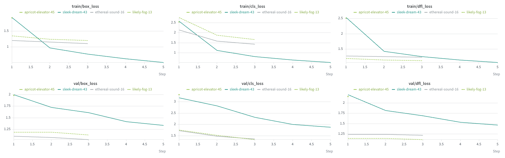
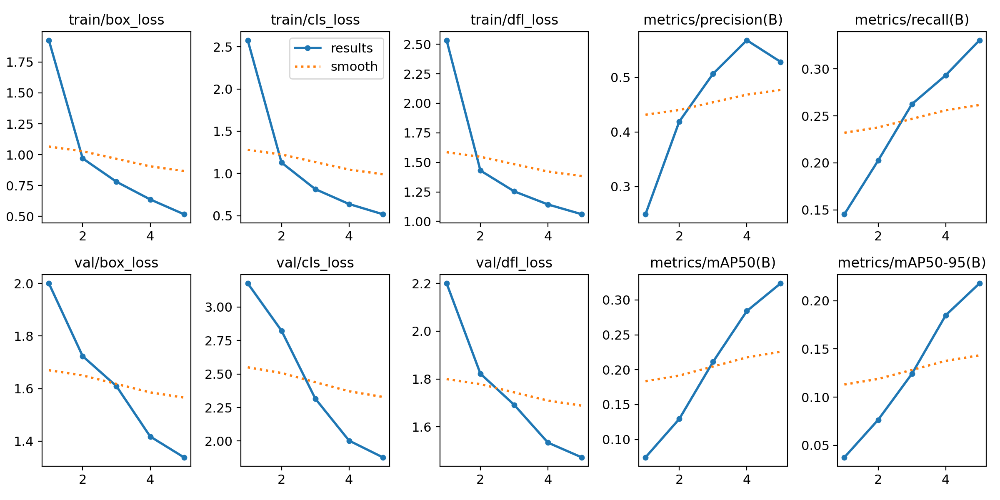
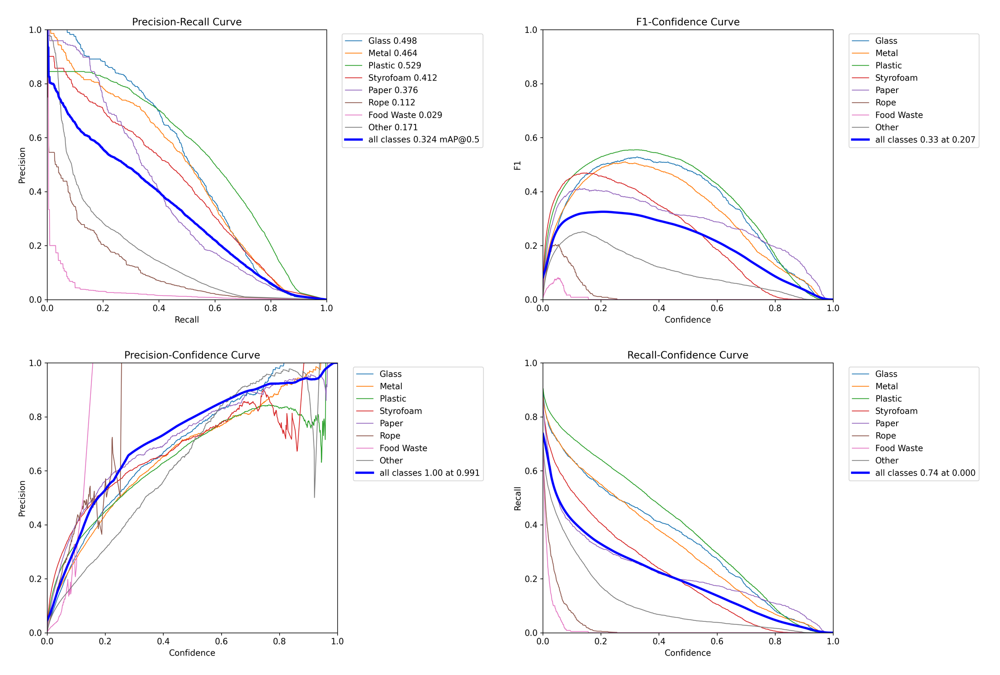
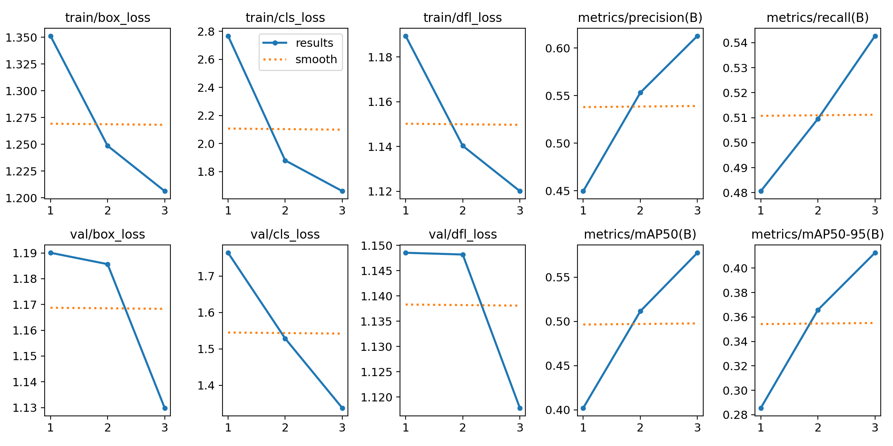
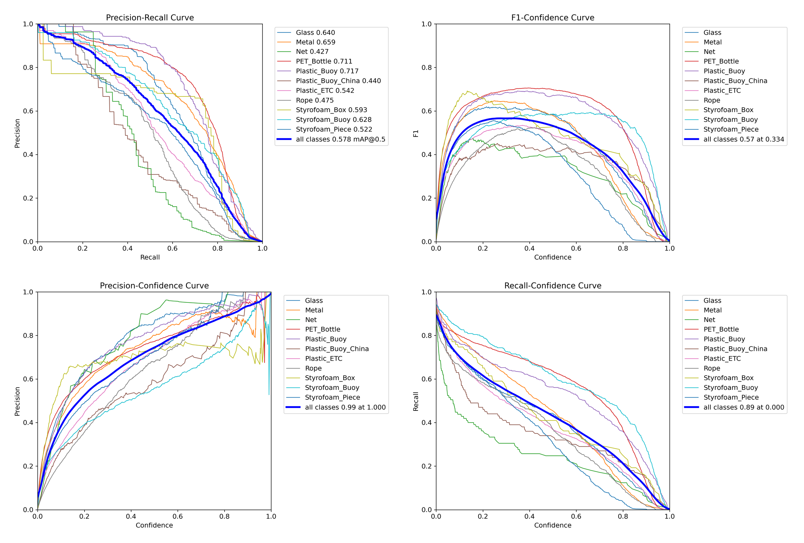
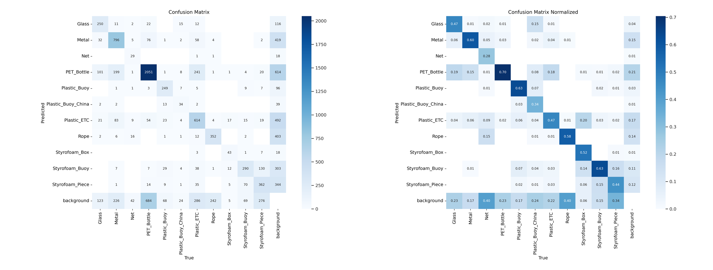
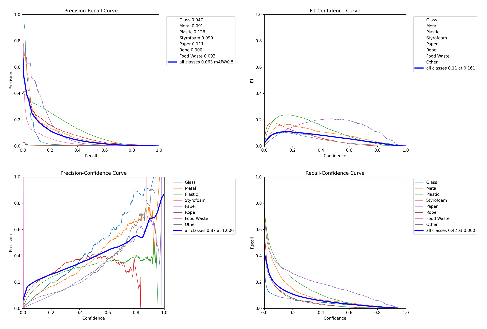
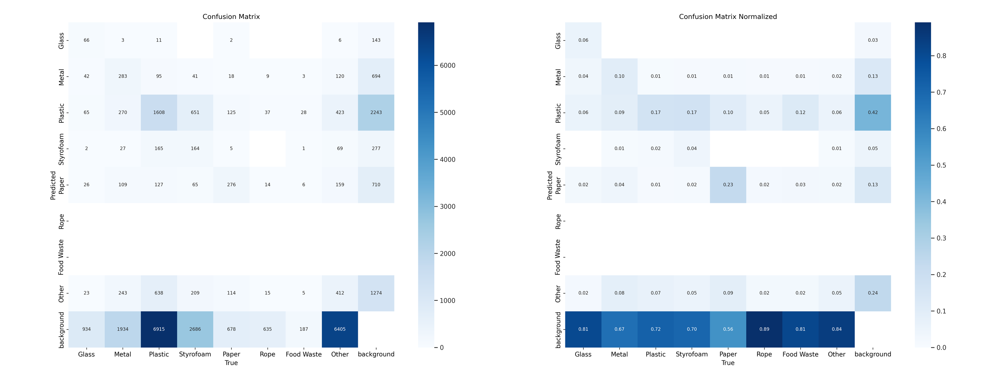

# Recon Drone — waste detection from drone imagery

YOLO11 object detection with a Flask inference backend and a React heatmap web app. A Marlborough College Malaysia (MCM) team built it for the Planet Protectors Challenge at **Google EDUtech Asia 2024** in Singapore. The team won **first place**.

[Project page](https://sienarindustries.com/project/edutech) ·
[Model weights on Hugging Face](https://huggingface.co/shng2025/EduTech-YOLOv11) ·
[Interactive W&B training report](https://forge.coreweave.com/wandb/marlborough-college-malaysia/Edutech/reports/Recon-Drone-MCM-Edutech-Asia--VmlldzoxODE0OTE0OA) ·
[Training report (PDF)](docs/recon-drone-training-report.pdf) ·
[Instagram @mcmedutech](https://www.instagram.com/mcmedutech/)

<p align="center">
  
</p>

## Videos

<table>
  <tr>
    <td width="33%"><a href="https://youtube.com/shorts/AQ2-JziMWtg"></a></td>
    <td width="33%"><a href="https://youtu.be/nM7g6zC_H5I"></a></td>
    <td width="33%"><a href="https://youtu.be/0D65uZaONBg"></a></td>
  </tr>
  <tr>
    <td align="center"><b>Project video</b> (1 min)<br>Coastal litter detection with YOLO<br><a href="https://youtube.com/shorts/AQ2-JziMWtg">link</a></td>
    <td align="center"><b>Finale team presentation</b><br>Google EDUtech Asia 2024<br><a href="https://youtu.be/nM7g6zC_H5I">link</a></td>
    <td align="center"><b>Main-stage pitch</b><br>Marina Bay Sands Expo, Singapore<br><a href="https://youtu.be/0D65uZaONBg">link</a></td>
  </tr>
</table>

## What it does

A DJI drone flies a planned route and captures geotagged photos. A YOLO11 model finds waste in each photo and sorts it into eight classes. The backend reads the GPS position from the EXIF data of the photo. It stores the photo and the result in Firebase. The web app draws the detections as a heatmap on Google Maps.

<p align="center"></p>

| Part | What it is | Who built it |
|---|---|---|
| `training/`, `notebooks/` | Dataset pipeline, YOLO training, W&B tracking, checkpoints to Hugging Face | Shi Hao Ng |
| `webapp/backend/` | Flask API that runs the model, reads EXIF GPS and writes to Firebase | Jolie Teo |
| `webapp/DroneDataVisualization/` | React + Vite front end with a Google Maps heatmap | Jolie Teo, Jonatas |
| Drone | DJI SDK route planning and image capture | Louis Gan |

## Repository layout

```
docs/                 photos, W&B charts, Ultralytics plots, the training report PDF
training/             scripts used on the rented H100 machine
  Edutech-Dataset.py    downloads 7 Roboflow datasets and merges them (needs ROBOFLOW_API_KEY)
  YOLOv11-run.py        trains yolo11l, logs to W&B, pushes a checkpoint per epoch to Hugging Face
  YOLOv11-ddp.py        multi-GPU variant of the same script
  args.yaml             the exact Ultralytics arguments of the final run
  inference.py          runs a checkpoint on a folder of images
notebooks/            Colab notebooks in date order, from the first ViT trial to the HF checkpoint loop
webapp/               the web app, imported from Crispy2chickens/edutech with its history
```

## Dataset

Seven public Roboflow datasets are downloaded in YOLO format and merged into one folder. The merge keeps every source class and prefixes each image with its dataset name. A second pass maps the source classes onto eight target classes.

| Target class | Source classes folded in |
|---|---|
| Glass | glass, glass bottle |
| Metal | metal, can, aluminium foil, pop tab |
| Plastic | plastic, PET bottle, plastic bag, plastic buoy, plastic container, bottle |
| Styrofoam | styrofoam box, buoy, piece, cup |
| Paper | paper, cardboard, carton |
| Rope | rope, net |
| Food Waste | food, decomposable |
| Other | other litter, straw, fabrics, wood, cigarette, wrapper, lid, bottle cap |

The seven sources on Roboflow Universe:

- `hongmo/sea-ezx3q` v44
- `kim-borma/marine-debris-vb2qm` v16
- `myfyp/new-taco` v3
- `anas-fd5bu/-kg` v5
- `trash-detection-eka7g/aeriel-trash-detection` v5
- `fyp-bfx3h/yolov8-trash-detections` v6 and `taco-ihjgk/yolov8-trash-detections-kgnug` v11

## Training

The first experiments ran on Google Colab. The final run ran on a rented NVIDIA H100 through SSH. The training script starts a W&B run and uses the run name as a Hugging Face branch. It pushes a checkpoint to that branch after every epoch. A crashed machine loses at most one epoch.

| Setting | Value |
|---|---|
| Model | `yolo11l.pt`, pretrained, 25.3 M parameters, 87 GFLOPs |
| Image size, batch | 640 px, 128 |
| Precision | AMP (fp16), `cache=ram`, 32 workers |
| Optimiser | Ultralytics auto, lr0 0.01, warm-up 3 epochs |
| Logging | W&B `marlborough-college-malaysia/Edutech`, one checkpoint per epoch to Hugging Face |

## Results

Five runs produced metrics. Four logged them to W&B. The final run trained with a script that had no W&B callback, so its curves come from the checkpoint itself. All runs are short because of time and GPU cost. Each number is on the validation split of that run's own dataset.

| Run | Date | Model | Classes | Epochs | mAP50 | mAP50-95 | Weights |
|---|---|---|---|---|---|---|---|
| likely-fog-13 | 2024-10-21 | YOLOv8n | 11 | 3 | 0.578 | 0.413 | not kept |
| ethereal-sound-16 | 2024-10-21 | YOLO11x | 40 | 3 of 5, crashed | 0.418 | 0.315 | not kept |
| sleek-dream-43 | 2024-10-23 | YOLO11l | 8 | 5 | 0.324 | 0.218 | `archive/sleek-dream-43` |
| apricot-elevator-45 | 2024-10-23 | YOLO11l | 8 | 1 | 0.064 | 0.033 | `archive/2024-10-23-yolo11l-1-epoch` |
| **fluent-morning-79** | 2024-11-07 | YOLO11l | 8 | 9 | **0.381** | **0.264** | **`weights/best.pt`** |

likely-fog-13 trained on one 11-class marine debris set. ethereal-sound-16 used 40 classes, most likely the merged set before the class mapping. Only the last three runs use the eight classes of the final model.

### W&B charts of the four logged runs

<p align="center"></p>
<p align="center"></p>

### fluent-morning-79: the final model

<p align="center"></p>

The curves were still rising when the run stopped after 9 of 50 epochs. W&B holds no Ultralytics plots for this run.

### sleek-dream-43: YOLO11l, 8 classes, 5 epochs

<p align="center"></p>
<p align="center"></p>
<p align="center"></p>
<p align="center"></p>

Plastic, Glass and Metal are the strongest classes. Rope, Food Waste and Other are mostly predicted as background.

<details>
<summary><b>likely-fog-13</b>: YOLOv8n, 11 classes, 3 epochs</summary>

<p align="center"></p>
<p align="center"></p>
<p align="center"></p>

</details>

<details>
<summary><b>apricot-elevator-45</b>: YOLO11l, 8 classes, 1 epoch</summary>

<p align="center"></p>
<p align="center"></p>

</details>

All 32 report panels are in `docs/wandb/panels/`. The single Ultralytics plots of each run are in `docs/wandb/plots/`. Per-epoch metrics of every run are in `docs/wandb/history/` as CSV. The [W&B report](https://forge.coreweave.com/wandb/marlborough-college-malaysia/Edutech/reports/Recon-Drone-MCM-Edutech-Asia--VmlldzoxODE0OTE0OA) is interactive. The [training report](docs/recon-drone-training-report.pdf) is the printed version with a run inventory.

## Use the weights

```bash
pip install ultralytics huggingface_hub
```

```python
from huggingface_hub import hf_hub_download
from ultralytics import YOLO

weights = hf_hub_download("shng2025/EduTech-YOLOv11", "weights/best.pt")
model = YOLO(weights)
results = model.predict("drone_photo.jpg", conf=0.25)
results[0].show()
```

The model returns boxes in the eight classes of the dataset table above. Every earlier checkpoint is kept under `archive/` on the Hugging Face repo with a README for each run.

## Web app

The user uploads a drone photo. The Flask backend runs the model and draws the boxes. It reads the GPS tags and stores both images in Firebase. The front end reads Firestore and draws markers and a heatmap. Setup steps are in [`webapp/README.md`](webapp/README.md). The original repository is [Crispy2chickens/edutech](https://github.com/Crispy2chickens/edutech).

## Reproduce the training

```bash
export ROBOFLOW_API_KEY=...        # your own Roboflow key
cd training
python Edutech-Dataset.py          # downloads and merges the datasets into combined_dataset/
wandb login && hf auth login       # the training script logs to W&B and pushes to Hugging Face
git clone https://huggingface.co/shng2025/EduTech-YOLOv11   # the script writes checkpoints into this folder
python YOLOv11-run.py
python inference.py                # predictions for combined_dataset/images/valid
```

## EDUtech Asia 2024

<table>
  <tr>
    <td></td>
    <td></td>
  </tr>
  <tr>
    <td></td>
    <td></td>
  </tr>
  <tr>
    <td></td>
    <td></td>
  </tr>
  <tr>
    <td></td>
    <td></td>
  </tr>
</table>

## Credits

- Shi Hao Ng ([Ice-Citron](https://github.com/Ice-Citron)): machine learning and training infrastructure. Initial team lead.
- Jolie Teo ([Crispy2chickens](https://github.com/Crispy2chickens)): web app and backend. Team lead.
- Jonatas: web app.
- Louis Gan: drone and DJI SDK.
- Marlborough College Malaysia CES Society.

License: MIT (see `LICENSE`).
