# Google EDUtech Asia 2024: Team Recon Drone

We (Jolie Teo, Olivier Bhogal, Jonatas Mancuso, Louis Gan and Shi Hao Ng)
represented Marlborough College Malaysia as Team Recon Drone, and participated
in Google EDUtech Asia's 2024 Planet Protectors Challenge held in Marina Bay
Sands, Singapore. We won first place.

We built a waste analytics platform, which relying on various sources of 
image input (e.g., drone photos, CCTVs, etc.), we use a SFT'd YOLOv11 model
to display the distribution of waste in a geographic location on a React heatmap 
overtime. This heatmap is useful because it allows relevant stakeholders to 
analyse where are waste accumulating in a country over-time, which allows
them to root out the cause behind such accumulation, and also to concentrate
waste-handling resources in the appropriate location.

[Project page](https://sienarindustries.com/project/edutech) ·
[Weights on Hugging Face](https://huggingface.co/shng2025/EduTech-YOLOv11) ·
[Weights and Biases report](https://forge.coreweave.com/wandb/marlborough-college-malaysia/Edutech/reports/Recon-Drone-MCM-Edutech-Asia--VmlldzoxODE0OTE0OA) ·
[Training report (PDF)](docs/recon-drone-training-report.pdf) ·
[Instagram](https://www.instagram.com/mcmedutech/) ·
[School article](https://www.marlboroughcollegemalaysia.org/mcm-success-at-edutech-asias-planet-protectors-challenge/)

<p align="center">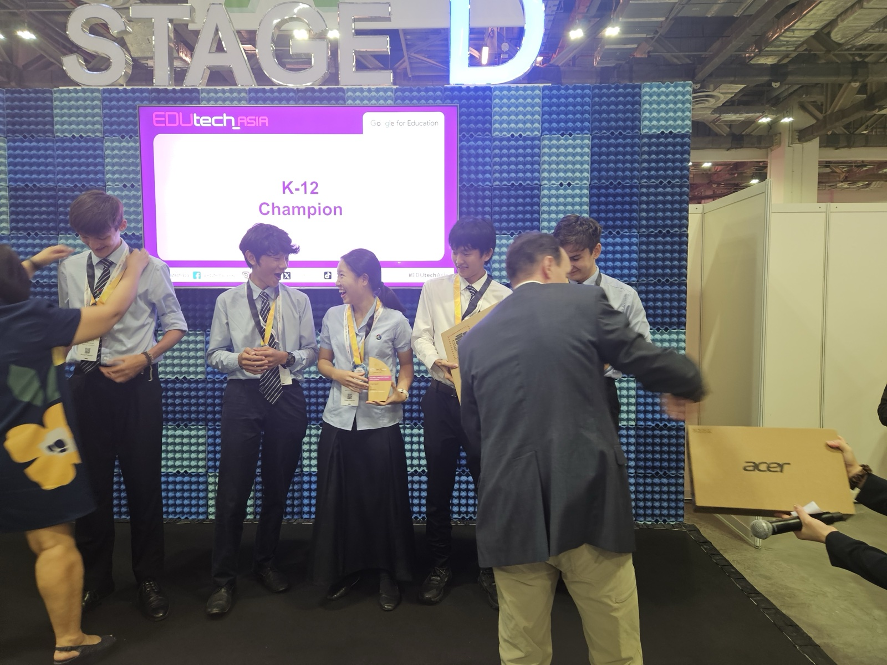</p>

## Videos

<table>
  <tr>
    <td width="33%"><a href="https://youtube.com/shorts/AQ2-JziMWtg"></a></td>
    <td width="33%"><a href="https://youtu.be/nM7g6zC_H5I"></a></td>
    <td width="33%"><a href="https://youtu.be/0D65uZaONBg"></a></td>
  </tr>
  <tr>
    <td align="center"><b>Project video</b> (1 min)<br>Coastal litter detection with YOLO<br><a href="https://youtube.com/shorts/AQ2-JziMWtg">link</a></td>
    <td align="center"><b>Finale team presentation</b><br>Google EDUtech Asia 2024<br><a href="https://youtu.be/nM7g6zC_H5I">link</a></td>
    <td align="center"><b>Main-stage pitch</b><br>Marina Bay Sands Expo, Singapore<br><a href="https://youtu.be/0D65uZaONBg">link</a></td>
  </tr>
</table>

## How it works

Images can come from any source that records where and when they were taken, such as a CCTV camera or a drone. In our prototype, we programmed a DJI drone using the DJI SDK to fly a pre-programmed route over beaches, plantations and rural villages with no existing infrastructure. Our Flask backend reads the GPS coordinates and timestamp from each image's metadata, before using our SFT'd YOLOv11 model to detect and classify waste into eight classes, then stores the results in Google Firebase. Next, the React web app plots these detections as an interactive heatmap on Google Maps. Since we store each image's date, this tool allows users (stakeholders) to geospatially track and analyse how waste levels in a region change month by month. This system was set up around our 90-acre school campus.

<p align="center">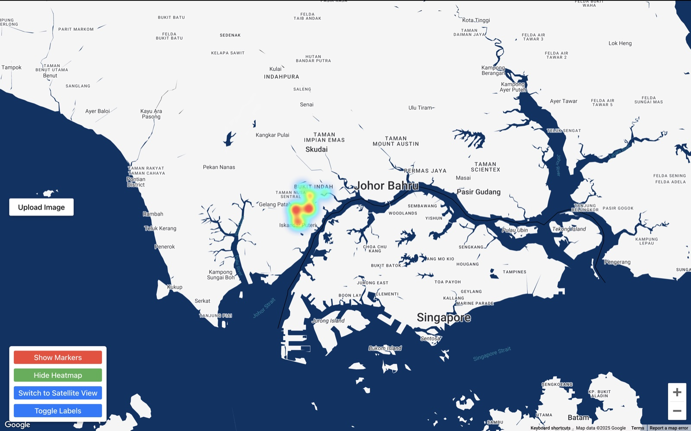</p>

```
training/   dataset preparation, training scripts and Colab notebooks
webapp/     Flask backend and React front end (from Crispy2chickens/edutech)
docs/       training guide, report PDF, W&B charts and photos
```

## Results

We first tested our training code on an NVIDIA L4 from Google Colab, because it's cheaper to fail and make mistakes in Google Colab. Then, once our training code is tested, we fine-tuned a YOLOv11l model on waste classification using NVIDIA H100 spot instances from Google Cloud GCP. We logged our training curves and data to Weights & Biases and upload each checkpoint onto Hugging Face. 

To fine-tune our computer vision model, we collected 300 thousand images from 25 open-source waste-classification related datasets and merged them on Roboflow. Our final model is a YOLOv11-L, fine-tuned for 9 epochs, reaching 0.381 mAP50 and 0.264 mAP50-95 on our validation set, and forward-passes an image in ~0.015 seconds on an NVIDIA L4. 

The charts below are our logged training results from Weights & Biases:

<p align="center">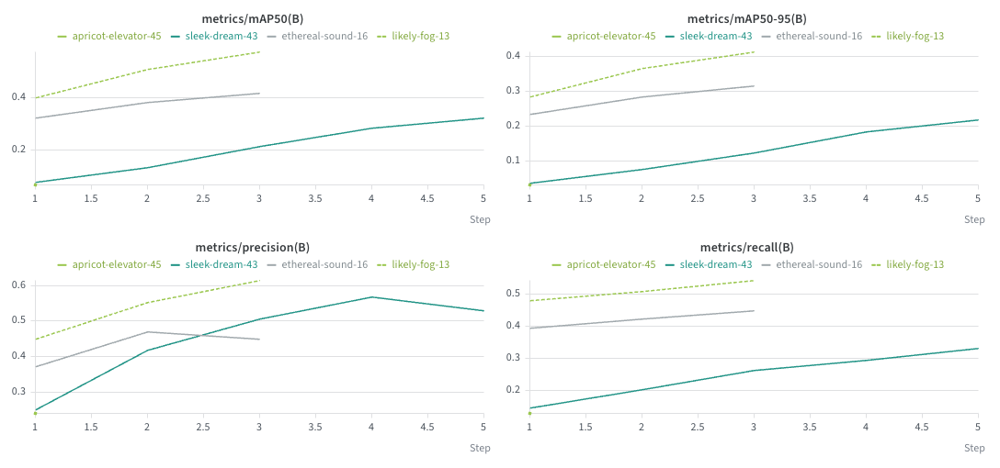</p>
<p align="center">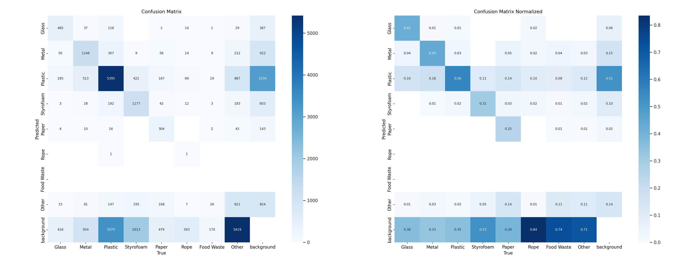</p>
<p align="center">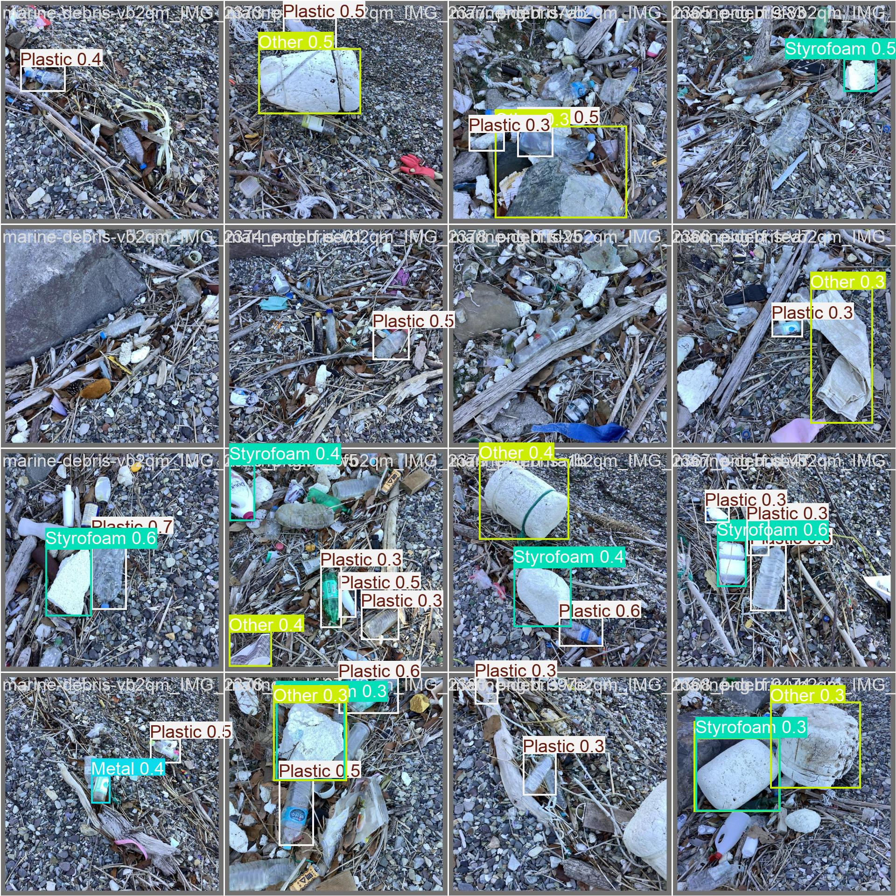</p>

To read more about the training runs, the datasets we built, and how to repeat our training, see [docs/training.md](docs/training.md).

## Use the model

```python
from huggingface_hub import hf_hub_download
from ultralytics import YOLO

model = YOLO(hf_hub_download("shng2025/EduTech-YOLOv11", "weights/best.pt"))
model.predict("drone_photo.jpg", conf=0.25)[0].show()
```

## EDUtech Asia 2024

<table>
  <tr>
    <td width="25%">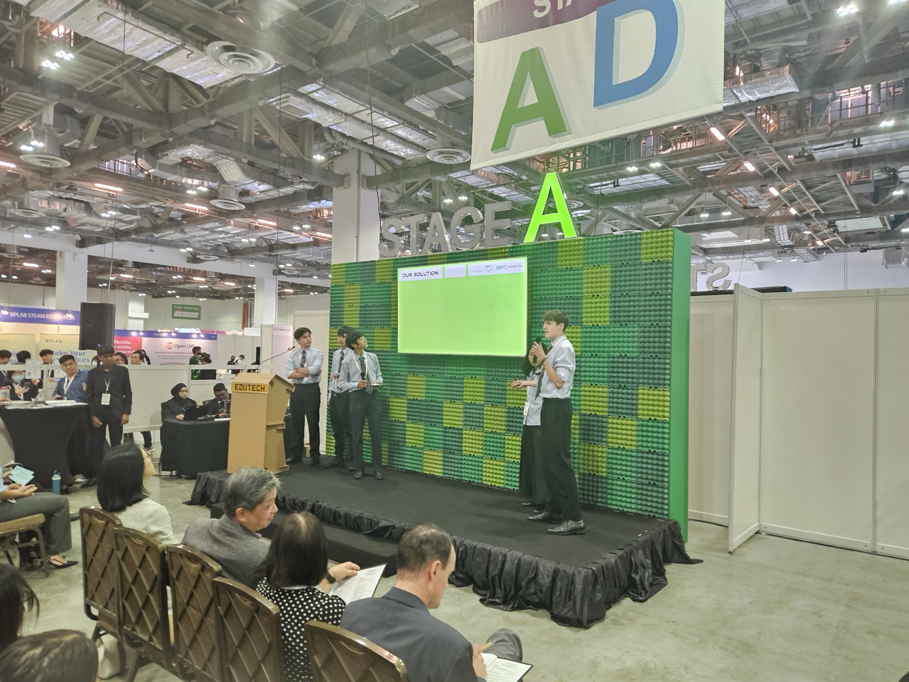</td>
    <td width="25%">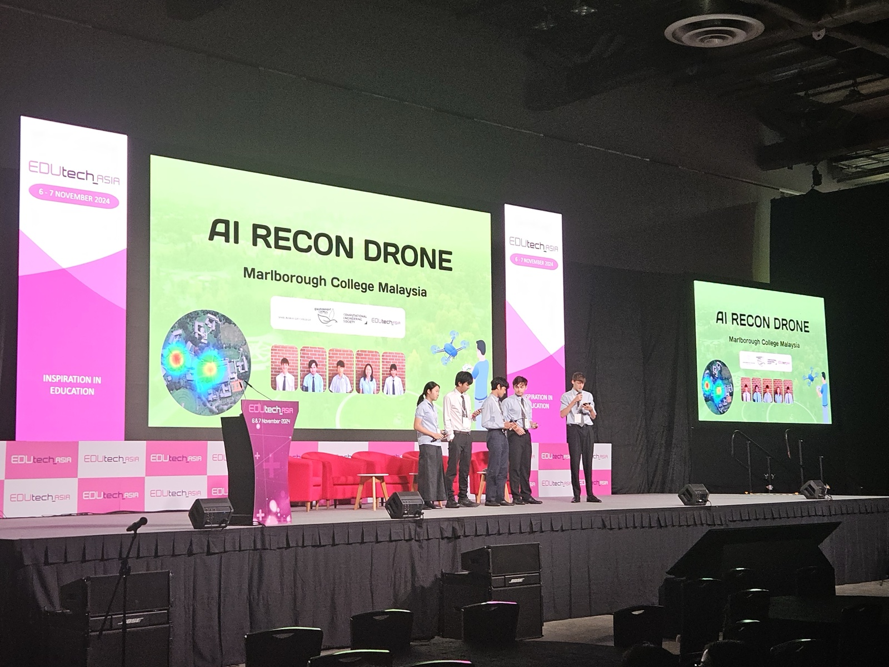</td>
    <td width="25%">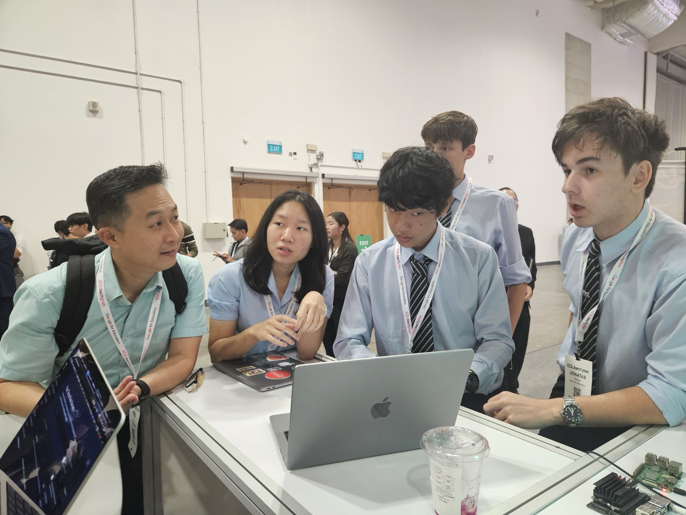</td>
    <td width="25%">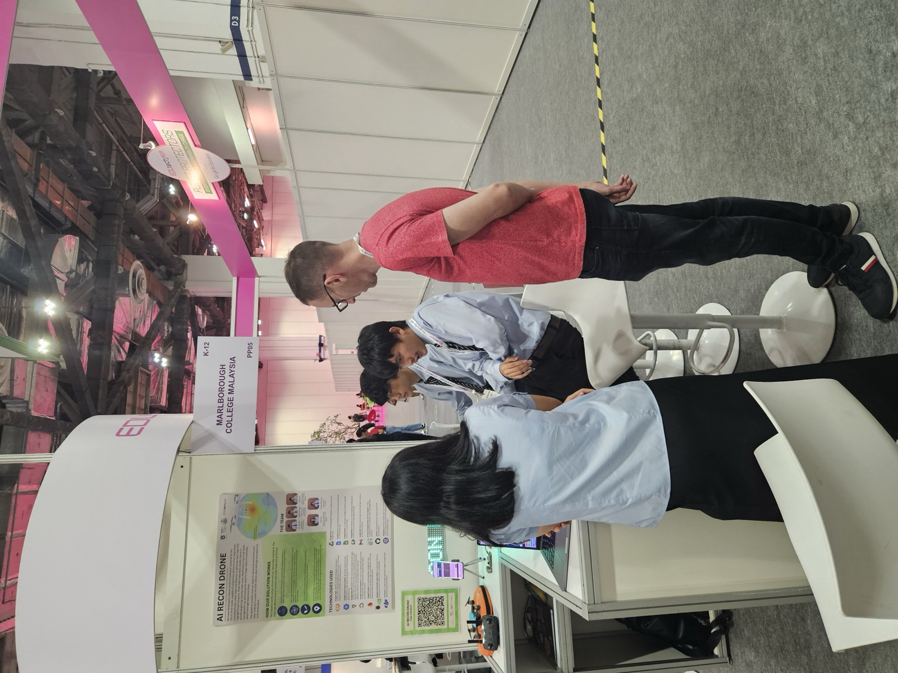</td>
  </tr>
  <tr>
    <td>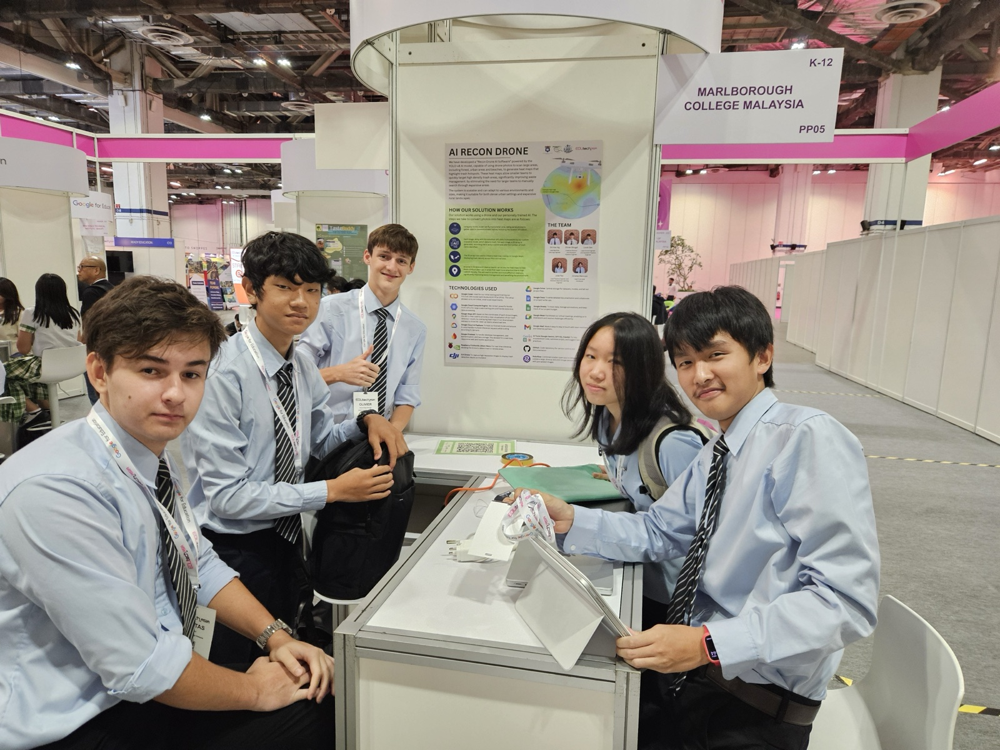</td>
    <td>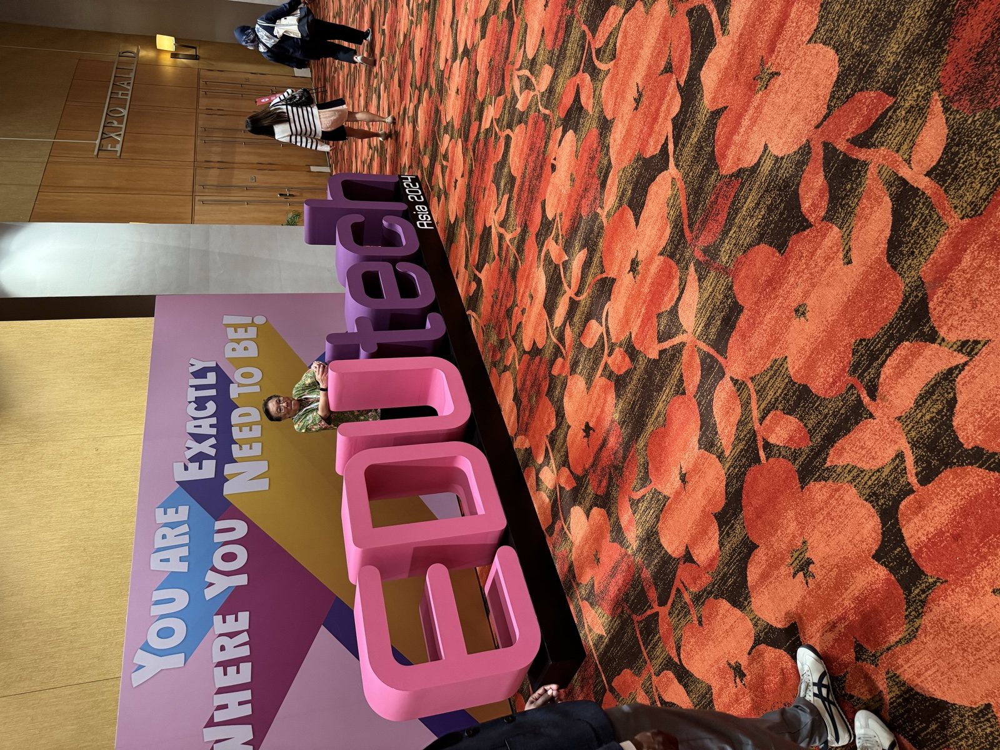</td>
    <td>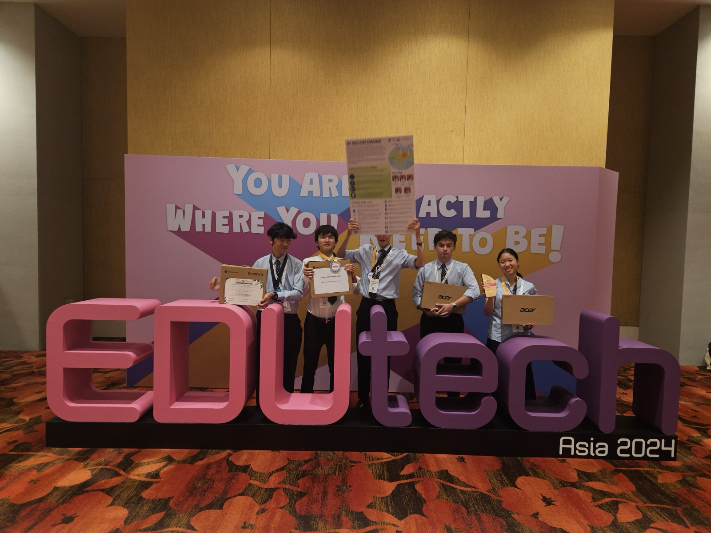</td>
    <td>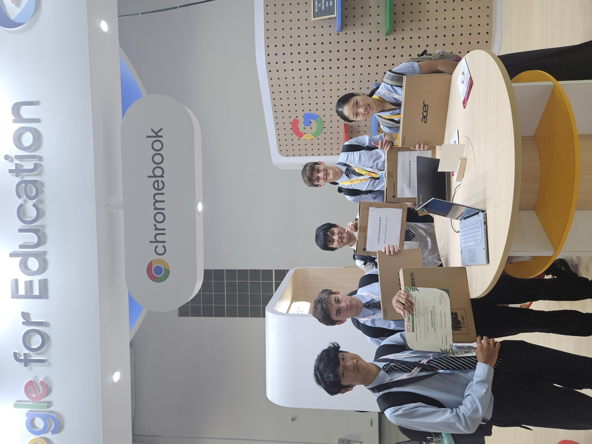</td>
  </tr>
</table>

## Credits

- Jolie Teo ([Crispy2chickens](https://github.com/Crispy2chickens)): web app and Firebase backend. Team lead.
- Olivier Bhogal: pitch and outreach.
- Jonatas Mancuso: web app and Google Maps heatmap.
- Louis Gan: drone and DJI SDK.
- Shi Hao Ng ([Ice-Citron](https://github.com/Ice-Citron)): machine learning, from the dataset pipeline to training. Initial team lead.

MIT License.
