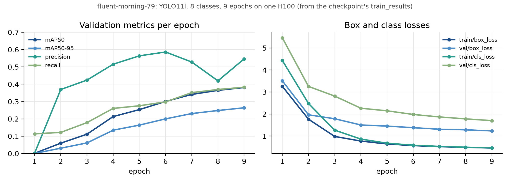

## Dataset

We merged about 300 thousand images from 25 open-source datasets on Roboflow. 
`training/prepare_dataset.py` downloads the seven Roboflow datasets into 
`combined_dataset/`, before then mapping their source classes onto the eight 
target classes below.

| Class | Source classes folded in |
|---|---|
| Glass | glass, glass bottle |
| Metal | metal, can, aluminium foil, pop tab |
| Plastic | plastic, PET bottle, plastic bag, plastic buoy, plastic container, bottle |
| Styrofoam | styrofoam box, buoy, piece, cup |
| Paper | paper, cardboard, carton |
| Rope | rope, net |
| Food Waste | food, decomposable |
| Other | other litter, straw, fabrics, wood, cigarette, wrapper, lid, bottle cap |

## Runs

| Run | Date | Model | Classes | Epochs | mAP50 | mAP50-95 |
|---|---|---|---|---|---|---|
| likely-fog-13 | 2024-10-21 | YOLOv8n | 11 | 3 | 0.578 | 0.413 |
| ethereal-sound-16 | 2024-10-21 | YOLO11x | 40 | 3 of 5, crashed | 0.418 | 0.315 |
| sleek-dream-43 | 2024-10-23 | YOLO11l | 8 | 5 | 0.324 | 0.218 |
| apricot-elevator-45 | 2024-10-23 | YOLO11l | 8 | 1 | 0.064 | 0.033 |
| **fluent-morning-79** | 2024-11-07 | YOLO11l | 8 | 9 | **0.381** | **0.264** |

<p align="center"></p>

> Note: Each run uses its own validation split, so the numbers are not directly comparable.

If you want to explore the runs yourself, visit [W&B report](https://forge.coreweave.com/wandb/marlborough-college-malaysia/Edutech/reports/Recon-Drone-MCM-Edutech-Asia--VmlldzoxODE0OTE0OA) which is interactive, and [recon-drone-training-report.pdf](recon-drone-training-report.pdf) is a printed version of the report.

## Settings of the final run

| Setting | Value |
|---|---|
| Model | `yolo11l.pt`, pretrained, 25.3 M parameters |
| GPU | one NVIDIA H100, Google Cloud spot instance |
| Image size, batch | 640 px, 128 |
| Precision | AMP (fp16), `cache=ram`, 32 workers |
| Optimiser | Ultralytics auto, lr0 0.01, warm-up 3 epochs |
| Checkpoints | one per epoch, pushed to the Hugging Face repo |

The full list of arguments we passed to Ultralytics is in `training/configs/final_run_args.yaml`.

## Reproduce

```bash
export ROBOFLOW_API_KEY=...        # your own Roboflow key
cd training
python prepare_dataset.py          # downloads, merges and maps the datasets into combined_dataset/
wandb login && hf auth login
git clone https://huggingface.co/shng2025/EduTech-YOLOv11   # train.py writes checkpoints into this clone
python train.py                    # train_ddp.py is the multi-GPU variant
python inference.py                # predictions on combined_dataset/images/valid
```

## Notebooks

`training/notebooks/` holds our Colab notebooks in date order, and together they show how the project evolved, from the ViT classifier we first tried in September 2024 to the YOLOv11 training loop with per-epoch Hugging Face checkpoints we ended up with in October 2024. `docs/media/2024-10-04-yolov8-seg-demo.avi` is the output of our first YOLOv8 notebook.
